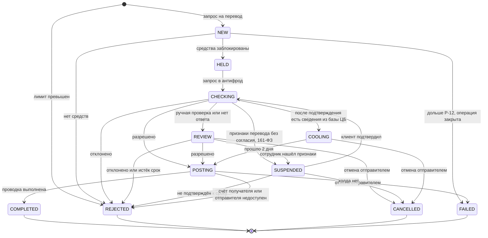

# Переводы по номеру телефона

[](https://github.com/KORTEZZ12/phone-transfers/actions/workflows/checks.yml)
[](https://kortezz12.github.io/phone-transfers/api/)

Системный анализ перевода между клиентами банка по номеру телефона. Здесь требования, контракты и модель данных, а ещё проверки, которые CI гоняет на каждый PR. Главный вопрос проекта: что будет с деньгами, когда что-то пошло не так? Двойное нажатие. Потерянный ответ. Антифрод, который лежит полчаса в час пик. Тридцать переводов одному человеку в одну секунду.

Проект учебный, банк вымышленный. Как я организовал работу, рассказываю в [docs/00-process.md](docs/00-process.md).

**Стек артефактов:** REST и OpenAPI 3.1 · Kafka и AsyncAPI 3.1 · SOAP · PostgreSQL и SQL · UML: sequence и state · BPMN 2.0 · ER · ADR · Gherkin · GitHub Actions

## Если есть 5 минут

1. [Таблица отказов](docs/design/failure-modes.md): 30 сценариев. В каждом видно, что сломалось, что делает система и что видит клиент.
2. [SD-2](docs/design/sequences.md#sd-2-повторы-и-потерянный-ответ) и [SD-5](docs/design/sequences.md#sd-5-неизвестный-исход-проводки): потерянный ответ и неизвестный исход проводки.
3. [ADR-001](docs/decisions/adr/ADR-001-sync-until-hold.md): почему клиент ждёт ответа только до блокировки суммы.
4. [Ревью](docs/reviews/README.md): две независимые проверки нашли 21 проблему, каждую я завёл issue и закрыл PR.
5. [Итерация 3](docs/testing/README.md): mock-сервер с правилами проекта и Postman-коллекция по таблице отказов. Каждый ответ сверяется с OpenAPI. Mock нашёл восемь мест, где требования не давали ответа.

Так перевод проходит статусы внутри сервиса:



## Что показывает проект

| Что умею | Где видно |
|---|---|
| Писать требования, которые можно проверить | [Бизнес-правила](docs/requirements/business-rules.md) с параметрами вместо чисел в тексте, [НФТ](docs/requirements/nfr.md) с точкой измерения, [истории](docs/requirements/user-stories.md) с критериями на Gherkin, [трассировка](docs/requirements/business-rules.md#трассировка-правило--проверка) каждого правила до проверки |
| Проектировать интеграции | [OpenAPI](docs/api/openapi.yaml), где у каждого кода ошибки есть реакция приложения; [AsyncAPI](docs/api/asyncapi.yaml); SOAP ЦБ, [сверенный живым вызовом](docs/integrations/cbr-dailyinfo.md) |
| Закладывать надёжность | Идемпотентность, outbox, задачи продолжения в той же транзакции, что и статус; [гонки проверены нагрузочным тестом](docs/design/ledger-concurrency-check.sh) |
| Работать с данными | [Модель данных](docs/design/data-model.md): правила держит база, а не текст; 24 проверки на PostgreSQL 16. [Сверка и витрина](docs/design/reconciliation.md): расхождения в деньгах и метрики видения одним запросом |
| Проверять требования | [Mock-сервер](mock/README.md) с правилами проекта и сбоями по запросу, [Postman-коллекция](docs/testing/README.md) по таблице отказов и историям, [матрица покрытия](docs/testing/coverage.md) строк, правил и историй |
| Описывать процессы с людьми | [BPMN процесса по 161-ФЗ](docs/design/bpmn/README.md), [runbook](docs/operations/runbook.md) операционного отдела, [состояния экрана](docs/design/client-states.md) |
| Принимать и объяснять решения | [Журнал решений](docs/decisions/decision-log.md) и шесть [ADR](docs/decisions/adr) с отвергнутыми вариантами |
| Работать с замечаниями | [Отчёты ревью](docs/reviews/README.md), issues и PR по каждой находке |

## Как проверить самому

```bash
cd docs/design
createdb pt_check && psql -v ON_ERROR_STOP=1 -d pt_check -f ddl.sql -f ddl-checks.sql
DB=pt_check ./concurrency-check.sh
createdb pt_conc && psql -d pt_conc -f ddl.sql && DB=pt_conc ./ledger-concurrency-check.sh
```

Mock-сервер и Postman-коллекция:

```bash
cd tests && npm ci && cd ..
MOCK_AUTO_TICK_MS=0 node mock/server.mjs &
npx --prefix tests newman run tests/postman/phone-transfers.postman_collection.json -e tests/postman/mock.postman_environment.json
node tests/concurrency-check.mjs
```

Сверка и витрина: `createdb pt_recon && psql -d pt_recon -f ddl.sql -f reconciliation.sql -f reconciliation-checks.sql` в `docs/design`.

Всё это и проверку контрактов CI запускает на каждый PR: [checks.yml](.github/workflows/checks.yml).

## Кто что делал

Предметную область, правила продукта и решения выбирал я: они в [журнале решений](docs/decisions/decision-log.md) вместе с причинами и отвергнутыми вариантами. ИИ (Claude) писал черновики по моим вводным и делал независимое ревью. Находки ревью заведены в issues, исправления прошли через PR.

## Карта артефактов

| Артефакт | Где | Версия |
|---|---|---|
| Как устроена работа, ретро | [docs/00-process.md](docs/00-process.md) | 0.4 |
| Видение, метрики, границы | [docs/requirements/vision.md](docs/requirements/vision.md) | 0.4 |
| Бизнес-правила, параметры, пуши, трассировка | [docs/requirements/business-rules.md](docs/requirements/business-rules.md) | 0.4 |
| Пользовательские истории | [docs/requirements/user-stories.md](docs/requirements/user-stories.md) | 0.4 |
| Нефункциональные требования | [docs/requirements/nfr.md](docs/requirements/nfr.md) | 0.3 |
| Глоссарий | [docs/requirements/glossary.md](docs/requirements/glossary.md) | 0.3 |
| Статусная модель, задачи продолжения | [docs/design/transfer-states.md](docs/design/transfer-states.md) | 0.4 |
| Таблица отказов | [docs/design/failure-modes.md](docs/design/failure-modes.md) | 0.4 |
| Sequence-диаграммы | [docs/design/sequences.md](docs/design/sequences.md) | 0.3 |
| BPMN | [docs/design/bpmn](docs/design/bpmn/README.md) | 0.3 |
| Состояния экрана | [docs/design/client-states.md](docs/design/client-states.md) | 0.4 |
| Модель данных, DDL, проверки | [docs/design/data-model.md](docs/design/data-model.md) | 0.4 |
| OpenAPI, AsyncAPI, соглашения | [docs/api](docs/api/README.md) | 0.4 |
| Интеграции: справочник, леджер, антифрод, ЦБ | [docs/integrations](docs/integrations/README.md) | 0.4 |
| Runbook | [docs/operations/runbook.md](docs/operations/runbook.md) | 0.4 |
| ADR и журнал решений | [docs/decisions](docs/decisions/decision-log.md) | 0.4 |
| Отчёты ревью | [docs/reviews](docs/reviews/README.md) | 0.4 |
| Mock-сервер | [mock](mock/README.md) | 0.4 |
| Postman-коллекция, матрица покрытия, находки итерации 3 | [docs/testing](docs/testing/README.md) | 0.4 |
| Сверка и витрина для отчётности | [docs/design/reconciliation.md](docs/design/reconciliation.md) | 0.4 |

## Статус

Версия 0.4. Готовы все четыре итерации: требования, контракты, модель данных, интеграции, ревью и исправления по нему, mock-сервер, Postman-коллекция по таблице отказов, сверка и витрина. Из решений по находкам итерации 3 приняты D-17 и D-18, D-15, D-16 и D-19…D-22 ждут подтверждения. [CHANGELOG](CHANGELOG.md).
