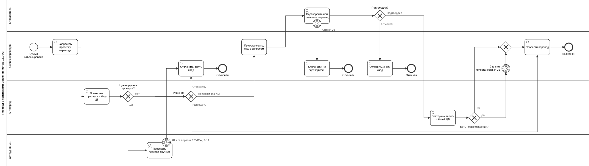

# BPMN

| Процесс | Файл | Превью |
|---|---|---|
| Перевод с признаками мошенничества по 161-ФЗ: проверка антифродом, ручная проверка, приостановка, подтверждение клиентом, отложенное исполнение | [`antifraud-161fz.bpmn`](antifraud-161fz.bpmn) | [`antifraud-161fz.svg`](antifraud-161fz.svg) |

BPMN 2.0 с разметкой диаграммы: открывается в [bpmn.io](https://demo.bpmn.io) или Camunda Modeler. Превью и `.bpmn` строятся из одной раскладки скриптом [`scripts/bpmn-161fz-layout.py`](../../../scripts/bpmn-161fz-layout.py), поэтому не расходятся. CI проверяет схему, висящие узлы и разметку.

На диаграмме не показана отмена отправителем на шагах ожидания: она возможна на проверке, при ожидании подтверждения и в отложенном исполнении (TR-22), но загромоздила бы схему. Правило и переходы — в [статусной модели](../transfer-states.md).
