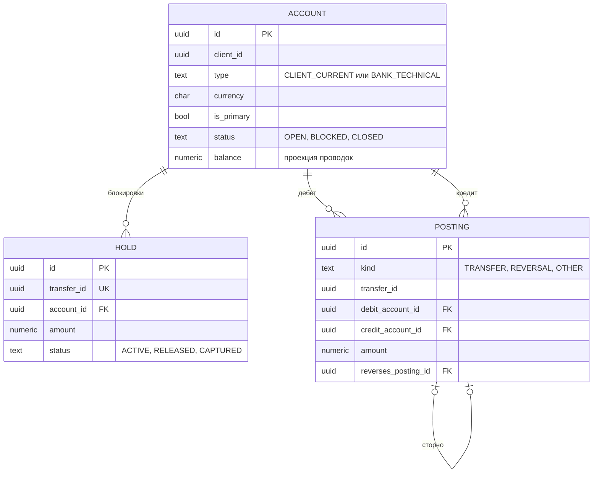
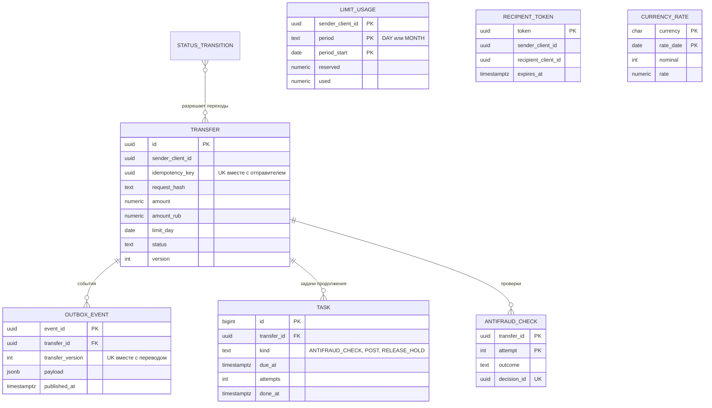

# Модель данных

Версия 0.2. DDL — [`ddl.sql`](ddl.sql), PostgreSQL 16. Две схемы соответствуют двум базам двух сервисов: `ledger` и `transfers`. Внешних ключей между ними нет: в проде это разные базы, связь — через [API леджера](../integrations/ledger.md).

Правила, которые можно гарантировать в базе, гарантируются в базе, а не обещаются в документе. Это проверяют [`ddl-checks.sql`](ddl-checks.sql) и [`concurrency-check.sh`](concurrency-check.sh).

## Как проверить

```bash
createdb pt_check
psql -v ON_ERROR_STOP=1 -d pt_check -f ddl.sql -f ddl-checks.sql   # каждая проверка печатает ok, в конце «Все проверки пройдены»
DB=pt_check ./concurrency-check.sh                                 # гонка за лимит в двух сессиях
createdb pt_conc && psql -d pt_conc -f ddl.sql
DB=pt_conc ./ledger-concurrency-check.sh                           # 110 параллельных операций леджера без взаимоблокировок
```

То же самое запускает CI на каждый PR: [`.github/workflows/checks.yml`](../../.github/workflows/checks.yml).

## Леджер



Проводка — одна строка «дебет — кредит — сумма». Поэтому равенство дебета и кредита выполняется по построению, его не нужно проверять отдельно. Баланс счёта — проекция суммы проводок: его меняет триггер в той же транзакции, что и проводка. Изменить баланс в обход проводки нельзя, счёт открывается с нулём (триггер `guard_balance`). Ежедневная сверка (итерация 3) дополнительно проверяет, что проекция совпадает с суммой.

Если холд по переводу сняли раньше, чем он дошёл до леджера, transferId записывается в `closed_operation`. Запоздавший холд по нему уже не создаётся. Без этого перевод был бы закрыт как FAILED, а деньги заблокированы холдом, о котором сервис переводов не знает.

Счета не удаляются физически, только переходят в CLOSED. Поэтому внешние ключи без каскадов: удалять нечего, и каскад был бы мёртвой декларацией.

## Сервис переводов



## Правило → механизм → проверка

| Правило | Механизм в базе | Чем проверено |
|---|---|---|
| TR-02, TR-04 Токен только для того, кто искал; не себе | `recipient_token.sender_client_id`, CHECK отправитель ≠ получатель | ревью |
| TR-05 Один основной счёт в валюте | Частичный уникальный индекс `account_one_primary_per_currency` | ревью |
| TR-08 Лимит с учётом незавершённых, атомарно | `reserve_limit`: блокировка строк DAY и MONTH в одном порядке, проверка `reserved + used + сумма` | ddl-checks, concurrency-check |
| TR-09 Отказ возвращает лимит | Триггер `settle_limit` при переходе в финальный статус: резерв уменьшается, у COMPLETED растёт использованное | ddl-checks |
| TR-11 Повтор с тем же ключом | UNIQUE (`sender_client_id`, `idempotency_key`) и `request_hash`: сервис отличает повтор от другого перевода с тем же ключом; ключ хранится с переводом всегда | ddl-checks |
| TR-34 Аренда обработки | `lease_until` и `take_lease`: аренду берёт только тот, кто пришёл после её окончания | ddl-checks |
| TR-12 Холд не больше доступного остатка | `place_hold` блокирует строку счёта и считает остаток за вычетом активных холдов | ddl-checks |
| TR-14 Списание и зачисление одной операцией | `post_transfer`: проводка и списание холда в одной транзакции | ddl-checks |
| TR-15 Проводки неизменяемы, исправления сторно | Триггеры на UPDATE, DELETE, TRUNCATE; триггер `check_reversal` требует зеркального сторно | ddl-checks |
| TR-16 Операции леджера идемпотентны | UNIQUE `hold.transfer_id`, UNIQUE (`posting.transfer_id`, `kind`); функции возвращают результат первой операции; снятие до холда закрывает transferId в `closed_operation` | ddl-checks |
| Баланс — проекция проводок | Триггер `guard_balance`: баланс меняет только `apply_posting`, счёт открывается с нулём | ddl-checks |
| TR-18 Счёт получателя или отправителя недоступен | `post_transfer` блокирует оба счёта, проверяет статусы и возвращает RECIPIENT_ACCOUNT_UNAVAILABLE или SOURCE_ACCOUNT_UNAVAILABLE, не проводя | ddl-checks |
| TR-24 Операция в валюте счёта | Составные FK (`account_id`, `currency`) → `account (id, currency)` | ddl-checks |
| TR-27 Статус и событие в одной транзакции | Триггер `emit_event` пишет в `outbox_event`; UNIQUE (`transfer_id`, `transfer_version`) | ddl-checks |
| TR-29 Порядок событий одного перевода | `version` растёт на 1 при каждом изменении (триггер `guard_transfer`), уходит в событие как `transferVersion` | ddl-checks |
| Статусная модель | Таблица `status_transition` и триггер `guard_transfer`: запрещённый переход — ошибка, реквизиты перевода не меняются | ddl-checks |
| TR-17, TR-30 Следующий шаг не теряется | Триггер `enqueue_task` ставит задачу тем же переходом статуса; `retry_task` — пауза P-17; представление `attention` — что найдёт регламентная проверка | ddl-checks |
| TR-23 Отмена против одобрения | Условное обновление `… WHERE status = 'REVIEW'`: проигравшая сторона обновляет 0 строк и читает текущий статус | ddl-checks |

## Протокол блокировок

| Операция | Что блокируется | Зачем |
|---|---|---|
| Резерв лимита | Строки `limit_usage` DAY, затем MONTH | Параллельные переводы одного отправителя выстраиваются в очередь, порядок исключает взаимоблокировку |
| Любая операция леджера | Операция по `transferId` (advisory-блокировка на транзакцию) | Холд, снятие и проводка одного перевода не обгоняют друг друга |
| Холд | Строка счёта списания, `FOR NO KEY UPDATE` | Два холда не потратят один и тот же остаток |
| Проводка | Строка холда, затем оба счёта в порядке `id`, `FOR NO KEY UPDATE` | Проводки по одному счёту идут по очереди, встречные A→B и B→A не дают взаимоблокировку |

Почему `FOR NO KEY UPDATE`, а не `FOR UPDATE`. Внешние ключи проводки при вставке берут на счета `FOR KEY SHARE`. `FOR UPDATE` с ней конфликтует: две проводки с общим счётом держат по KEY SHARE и ждут друг друга. До версии 0.3 так и было, из 90 одновременных проводок одному получателю 68 падали с deadlock. `FOR NO KEY UPDATE` с KEY SHARE не конфликтует, а проводки по одному счёту по-прежнему выстраивает в очередь. Проверяет [`ledger-concurrency-check.sh`](ledger-concurrency-check.sh).
| Смена статуса перевода | Строка перевода, условие на текущий статус | Гонки решает первое зафиксированное изменение |
| Задача продолжения | Строка задачи, занятые исполнители пропускают (`SKIP LOCKED`) | Несколько исполнителей не берут одну задачу |

## Решения по данным

- **Суммы** — `numeric(19,2)`, в API — строка. Числа с плавающей точкой теряют копейки.
- **Рублёвый эквивалент** для лимитов считается при создании перевода: `amount × rate / nominal`, округление до копеек, половина — от нуля. Курс берётся на дату операции, дата сохраняется в `rate_date`.
- **Период лимита** фиксируется при создании (`limit_day`, `limit_month`). Перевод, созданный в 23:59 31-го числа и выполненный 1-го, расходует лимит октября, а не ноября.
- **Ключ идемпотентности** хранится вместе с переводом и уникален всегда, поэтому повтор распознаётся без срока. Отдельного хранилища ключей с TTL нет и быть не должно: после удаления ключа повтор создал бы второй перевод.
- **Отказ по лимиту** записывается сразу в REJECTED, без резерва и без событий: клиент получил отказ в ответе на запрос, а запись нужна, чтобы повтор с тем же ключом вернул тот же отказ.
- **Хранение**: переводы и проводки не удаляются, срок хранения — [NFR-09](../requirements/nfr.md).
