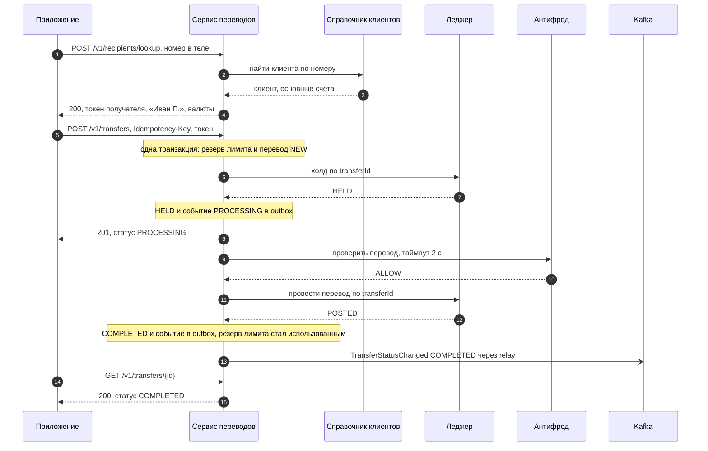
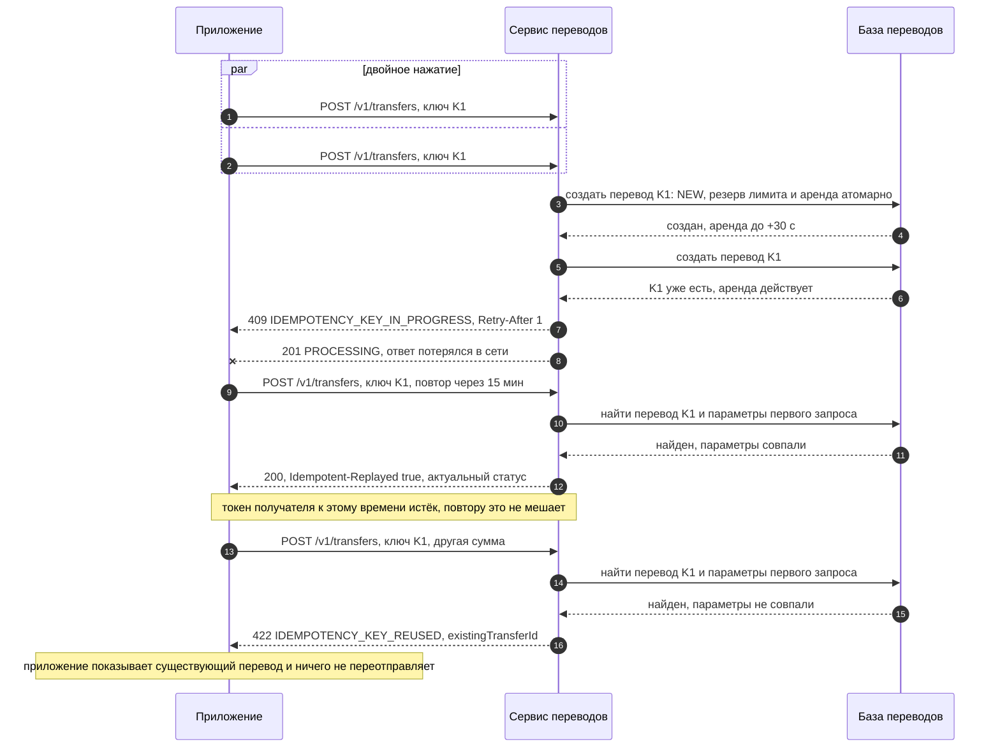
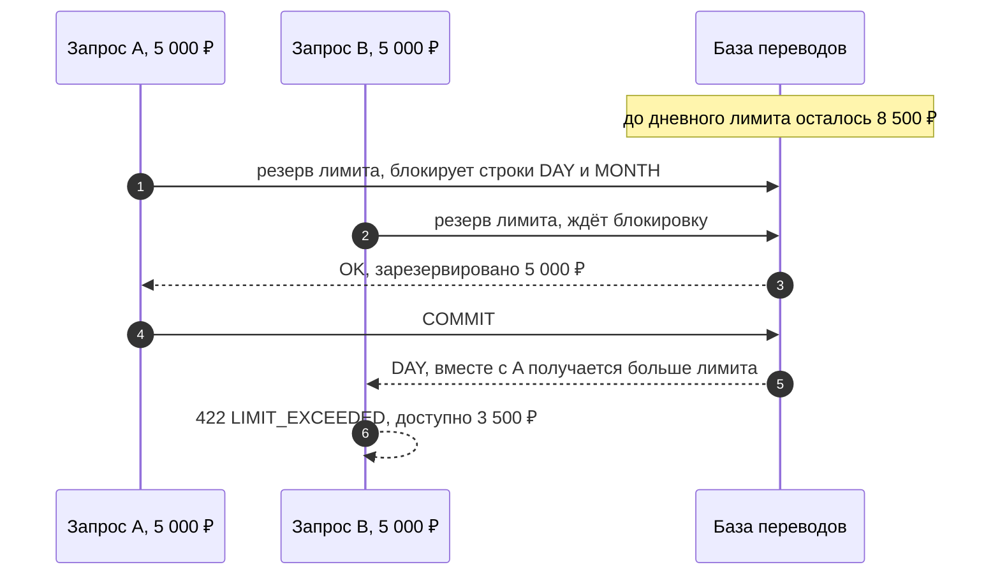
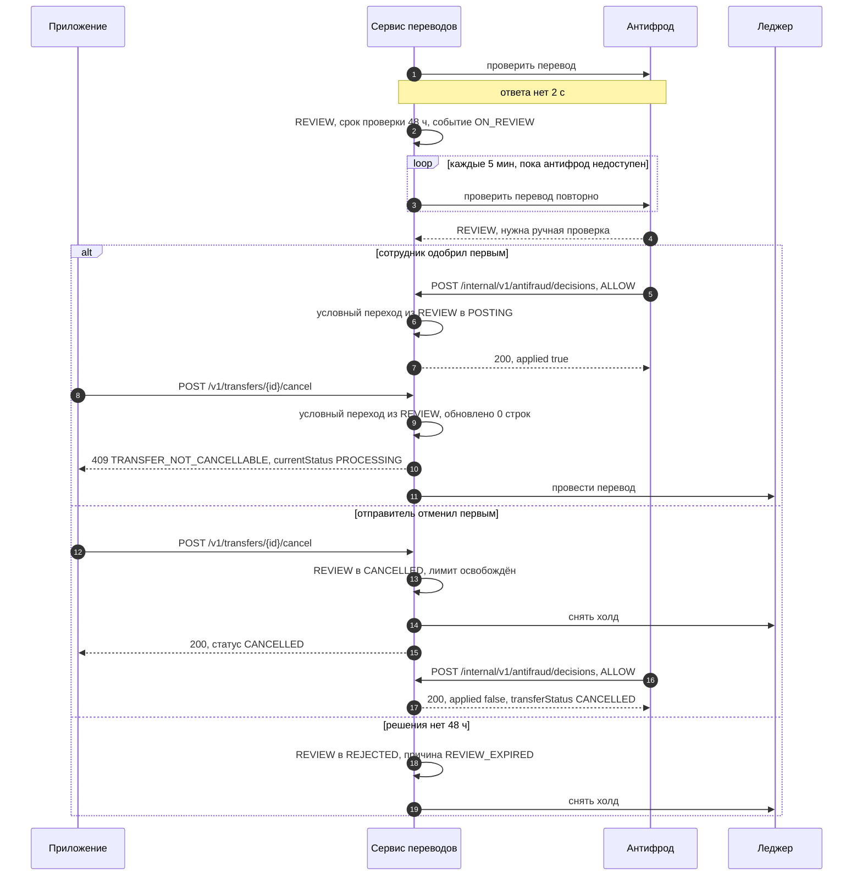
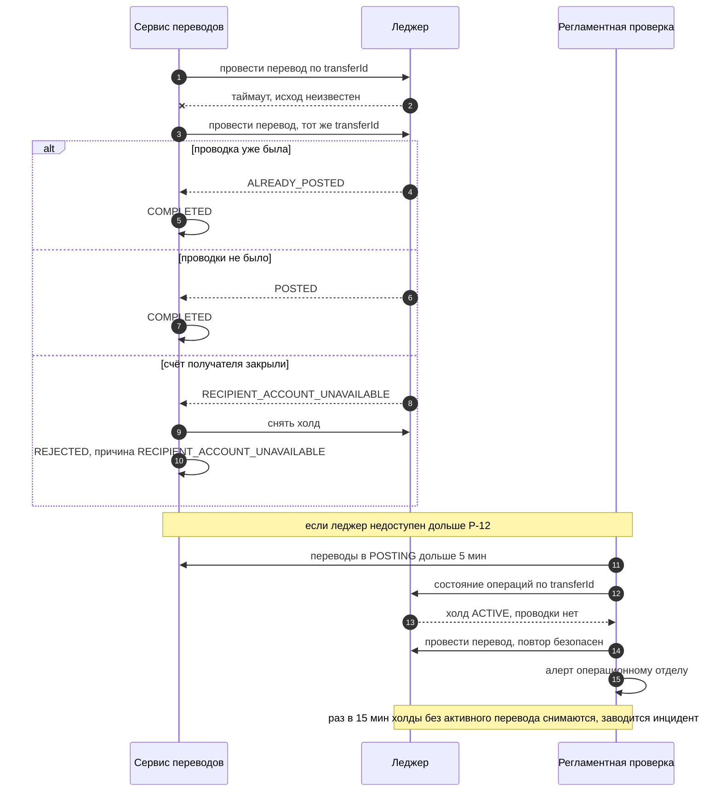
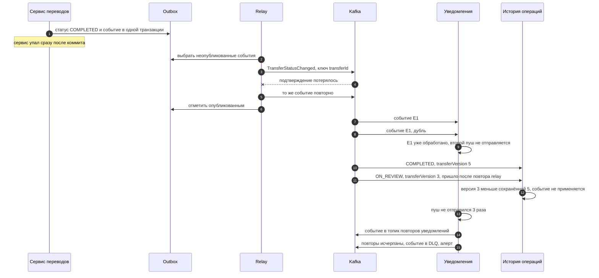

# Sequence-диаграммы

Версия 0.2. Каждая диаграмма разбирает строки [таблицы отказов](failure-modes.md). Вызовы и коды ответов совпадают с [OpenAPI](../api/openapi.yaml), события — с [AsyncAPI](../api/asyncapi.yaml), операции леджера — с [контрактом леджера](../integrations/ledger.md).

| Диаграмма | Строки таблицы отказов |
|---|---|
| [SD-1. Успешный перевод](#sd-1-успешный-перевод) | 10 |
| [SD-2. Повторы и потерянный ответ](#sd-2-повторы-и-потерянный-ответ) | 1, 2, 3 |
| [SD-3. Гонка за лимит](#sd-3-гонка-за-лимит) | 4 |
| [SD-4. Антифрод, ручная проверка, отмена](#sd-4-антифрод-ручная-проверка-отмена) | 5, 6, 7 |
| [SD-5. Неизвестный исход проводки](#sd-5-неизвестный-исход-проводки) | 8, 9, 15 |
| [SD-6. События: сбой, дубль, перестановка, DLQ](#sd-6-события-сбой-дубль-перестановка-dlq) | 11, 12, 13, 14 |

Строки 16 и 17 — ограничение частоты поиска и недоступность ЦБ — описаны в [OpenAPI](../api/openapi.yaml) и [интеграции с ЦБ](../integrations/cbr-dailyinfo.md).

## SD-1. Успешный перевод

Перевод идёт по токену из поиска, а не по номеру, поэтому смена владельца номера между поиском и подтверждением ничего не ломает.

## SD-2. Повторы и потерянный ответ

Ключ идемпотентности создаёт приложение, поэтому сервис отличает повтор от нового перевода. Ключ проверяется первым: повтору не мешают ни истёкший токен получателя, ни изменившийся лимит. Сравнение с параметрами первого запроса отличает честный повтор от ошибки приложения, которое переиспользовало ключ.

Если первый запрос упал до холда, перевод остаётся в NEW. Пока действует аренда P-14, повтор получает 409; после — берёт аренду и продолжает обработку с того же места, холд идемпотентен по transferId. Перевод, который провёл в NEW дольше P-12, закрывает регламентная проверка (TR-30).

## SD-3. Гонка за лимит

Проверено на PostgreSQL двумя параллельными сессиями: [`concurrency-check.sh`](concurrency-check.sh).

## SD-4. Антифрод, ручная проверка, отмена

## SD-5. Неизвестный исход проводки

Таймаут не значит «не проведено». Повтор с тем же transferId безопасен, потому что леджер идемпотентен.

## SD-6. События: сбой, дубль, перестановка, DLQ

Гарантия Kafka — «хотя бы один раз», поэтому дубли и повторы — норма, а не авария. Порядок событий одного перевода держит ключ transferId, а от перестановки при повторах relay защищает transferVersion.

