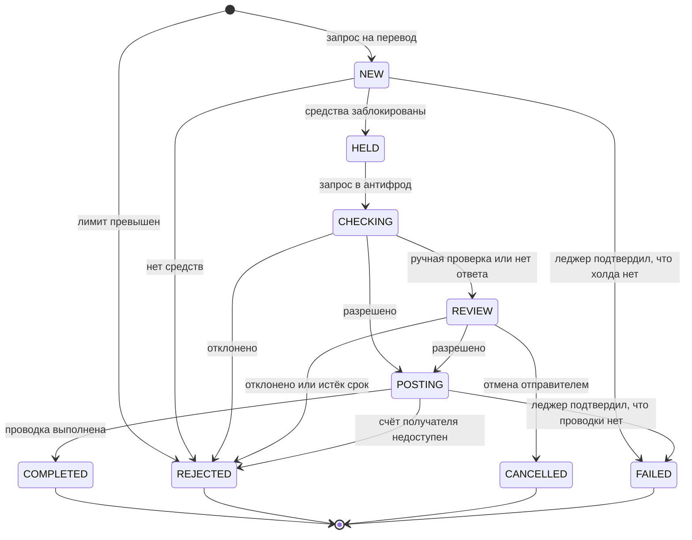

# Статусная модель перевода

Версия 0.2. Переходы зашиты в базу: таблица `status_transition` и триггер `guard_transfer` в [`ddl.sql`](ddl.sql), запрещённый переход — ошибка. Внутренних статусов больше, чем видит клиент: приложению не нужно знать, на каком шаге обработки перевод, ему нужно понимать, что делать человеку.

## Статусы

| Статус | Что значит | Что видит клиент | Деньги отправителя | Финальный |
|---|---|---|---|---|
| NEW | Перевод принят, ключ идемпотентности зафиксирован, лимит зарезервирован | В обработке | ещё не заблокированы | нет |
| HELD | Сумма заблокирована на счёте | В обработке | заблокированы | нет |
| CHECKING | Ждём решения антифрода | В обработке | заблокированы | нет |
| REVIEW | Ручная проверка или антифрод не ответил | На проверке, можно отменить | заблокированы | нет |
| POSTING | Антифрод разрешил, идёт проводка | В обработке | заблокированы | нет |
| COMPLETED | Проводка выполнена | Выполнен | списаны | да |
| REJECTED | Отклонён: лимит, нет средств, антифрод, истёк срок проверки, счёт получателя недоступен | Отклонён, с причиной | разблокированы или не блокировались | да |
| CANCELLED | Отменён отправителем на проверке | Отменён | разблокированы | да |
| FAILED | Технический сбой, леджер подтвердил, что операции не было | Не выполнен, деньги не списаны | разблокированы или не блокировались | да |

## Переходы

| Из | В | Событие | Кто | Правило |
|---|---|---|---|---|
| — | NEW | Запрос на перевод с новым ключом идемпотентности, лимит зарезервирован | Приложение | TR-08, TR-10 |
| — | REJECTED | Лимит превышен | Сервис переводов | TR-07, TR-08 |
| NEW | HELD | Леджер заблокировал сумму | Леджер | TR-12, TR-16 |
| NEW | REJECTED | Не хватает доступного остатка | Леджер | TR-12 |
| NEW | FAILED | Перевод завис дольше P-12, леджер подтвердил, что холда нет | Регламентная проверка | TR-30 |
| HELD | CHECKING | Запрос отправлен в антифрод | Сервис переводов | TR-19 |
| CHECKING | POSTING | Антифрод разрешил | Антифрод | TR-19 |
| CHECKING | REJECTED | Антифрод отклонил | Антифрод | TR-19 |
| CHECKING | REVIEW | Антифрод отправил на ручную проверку или не ответил за P-09 | Антифрод, сервис переводов | TR-20 |
| REVIEW | POSTING | Разрешено по итогам проверки | Антифрод | TR-21 |
| REVIEW | REJECTED | Отклонено по итогам проверки или истёк срок P-11 | Антифрод, сервис переводов | TR-21 |
| REVIEW | CANCELLED | Отправитель отменил | Приложение | TR-22, TR-23 |
| POSTING | COMPLETED | Леджер провёл дебет и кредит | Леджер | TR-14 |
| POSTING | REJECTED | Счёт получателя закрыт или заблокирован | Леджер | TR-18 |
| POSTING | FAILED | Перевод завис дольше P-12, леджер подтвердил, что проводки нет | Регламентная проверка | TR-30 |

## Инварианты

- Из финального статуса переходов нет. Событие, которое пытается перевести финальный перевод в другой статус, отклоняется и записывается в журнал.
- В статусах HELD, CHECKING, REVIEW и POSTING на счёте отправителя ровно один холд на сумму перевода. В NEW и в финальных статусах холда нет.
- У перевода в COMPLETED ровно одна пара проводок: дебет отправителя и кредит получателя.
- Отклонение по лимиту записывается сразу в REJECTED, без NEW: холда нет и снимать нечего. Запись нужна, чтобы повтор с тем же ключом вернул тот же отказ.
- Повтор запроса с тем же ключом не создаёт новый перевод и не меняет статус существующего.
