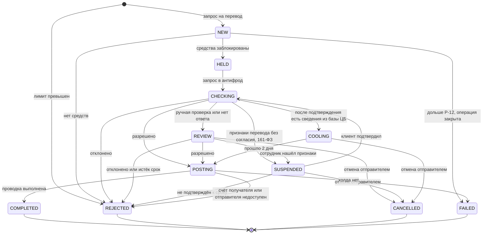

# Статусная модель перевода

Версия 0.3. Ниже — правила модели. Исполняемая проверка этих правил — таблица `status_transition` и триггер `guard_transfer` в [`ddl.sql`](ddl.sql): запрещённый переход — ошибка. Если модель реализуют в коде сервиса, правила не меняются, меняется только то, чем они проверены. Внутренних статусов больше, чем видит клиент: приложению не нужно знать, на каком шаге обработки перевод, ему нужно понимать, что делать человеку.

## Статусы

| Статус | Что значит | Что видит клиент | Деньги отправителя | Финальный |
|---|---|---|---|---|
| NEW | Перевод принят, ключ идемпотентности зафиксирован, лимит зарезервирован | В обработке | ещё не заблокированы | нет |
| HELD | Сумма заблокирована на счёте | В обработке | заблокированы | нет |
| CHECKING | Ждём решения антифрода | В обработке | заблокированы | нет |
| REVIEW | Ручная проверка или антифрод не ответил | На проверке, можно отменить | заблокированы | нет |
| SUSPENDED | Приостановлен по 161-ФЗ: признаки перевода без добровольного согласия, ждём подтверждения клиента до P-20 | Подтвердите перевод, можно отменить | заблокированы | нет |
| COOLING | Клиент подтвердил, но по базе ЦБ пришли сведения: исполнение отложено на P-21 | Будет выполнен после даты, можно отменить | заблокированы | нет |
| POSTING | Антифрод разрешил, идёт проводка | В обработке | заблокированы | нет |
| COMPLETED | Проводка выполнена | Выполнен | списаны | да |
| REJECTED | Отклонён: лимит, нет средств, антифрод, истёк срок проверки, не подтверждён клиентом, счёт получателя или отправителя недоступен | Отклонён, с причиной | разблокированы или не блокировались | да |
| CANCELLED | Отменён отправителем на проверке, при ожидании подтверждения или в отложенном исполнении | Отменён | разблокированы | да |
| FAILED | Технический сбой, леджер подтвердил, что операции не было | Не выполнен, деньги не списаны | разблокированы или не блокировались | да |

## Переходы

| Из | В | Событие | Кто | Правило |
|---|---|---|---|---|
| — | NEW | Запрос на перевод с новым ключом идемпотентности, лимит зарезервирован | Приложение | TR-08, TR-10 |
| — | REJECTED | Лимит превышен | Сервис переводов | TR-07, TR-08 |
| NEW | HELD | Леджер заблокировал сумму | Леджер | TR-12, TR-16 |
| NEW | REJECTED | Не хватает доступного остатка | Леджер | TR-12 |
| NEW | FAILED | Перевод провёл в NEW дольше P-12. Снятие холда закрывает операцию в леджере, запоздавший холд не появится | Регламентная проверка | TR-16, TR-30 |
| HELD | CHECKING | Запрос отправлен в антифрод | Сервис переводов | TR-19 |
| CHECKING | POSTING | Антифрод разрешил | Антифрод | TR-19 |
| CHECKING | REJECTED | Антифрод отклонил | Антифрод | TR-19 |
| CHECKING | REVIEW | Антифрод отправил на ручную проверку или не ответил за P-09 | Антифрод, сервис переводов | TR-20 |
| REVIEW | POSTING | Разрешено по итогам проверки | Антифрод | TR-21 |
| REVIEW | REJECTED | Отклонено по итогам проверки или истёк срок P-11 | Антифрод, сервис переводов | TR-21 |
| REVIEW | CANCELLED | Отправитель отменил | Приложение | TR-22, TR-23 |
| CHECKING | SUSPENDED | Антифрод нашёл признаки перевода без добровольного согласия или получателя в базе ЦБ | Антифрод | TR-35 |
| REVIEW | SUSPENDED | Сотрудник на ручной проверке нашёл такие признаки | Антифрод | TR-35 |
| SUSPENDED | CHECKING | Отправитель подтвердил до срока P-20, нужна повторная сверка с базой ЦБ | Приложение | TR-36, TR-37 |
| SUSPENDED | REJECTED | Срок P-20 прошёл без подтверждения, причина NOT_CONFIRMED | Регламентная проверка | TR-36 |
| SUSPENDED | CANCELLED | Отправитель отменил | Приложение | TR-22, TR-23 |
| CHECKING | COOLING | После подтверждения по базе ЦБ пришли сведения о получателе | Антифрод | TR-37 |
| COOLING | POSTING | Прошло P-21 | Задача возобновления | TR-37 |
| COOLING | CANCELLED | Отправитель отменил | Приложение | TR-22, TR-23 |
| POSTING | COMPLETED | Леджер провёл дебет и кредит | Леджер | TR-14 |
| POSTING | REJECTED | Счёт получателя закрыт или заблокирован, либо счёт отправителя заблокирован после холда | Леджер | TR-18 |
| POSTING | FAILED | Леджер ответил HOLD_RELEASED или NO_HOLD: холда нет, проводить нельзя. Инцидент | Сервис переводов | TR-30 |

## Инварианты

- Из финального статуса переходов нет. Событие, которое пытается перевести финальный перевод в другой статус, отклоняется и записывается в журнал.
- В статусах HELD, CHECKING, REVIEW, SUSPENDED, COOLING и POSTING на счёте отправителя ровно один холд на сумму перевода.
- Подтверждённый клиентом перевод второй раз не приостанавливается.
- После перехода в REJECTED, CANCELLED или FAILED холд снимает задача из той же транзакции. Пока она не выполнена, доступный остаток меньше на сумму перевода; обычно это доли секунды, при недоступном леджере — до его восстановления, с алертом через P-12.
- У перевода в HELD, CHECKING и POSTING всегда есть открытая задача продолжения. Перевод без неё — инцидент.
- У перевода в COMPLETED ровно одна пара проводок: дебет отправителя и кредит получателя.
- Отклонение по лимиту записывается сразу в REJECTED, без NEW: холда нет и снимать нечего. Запись нужна, чтобы повтор с тем же ключом вернул тот же отказ.
- Повтор запроса с тем же ключом не создаёт новый перевод и не меняет статус существующего.

## Задачи продолжения

Асинхронные шаги не вызываются «сразу после коммита», а ставятся задачей в той же транзакции, что и переход статуса ([ADR-005](../decisions/adr/ADR-005-continuation-tasks.md)). Шаг не теряется, даже если сервис упал сразу после коммита.

| Переход | Задача | Что делает исполнитель |
|---|---|---|
| NEW → HELD | Проверка антифродом | HELD → CHECKING, запрос в антифрод; ответ переводит в POSTING, REJECTED или REVIEW. Нет ответа — REVIEW, задача повторяется по TR-20 |
| SUSPENDED → CHECKING | Повторная сверка с базой ЦБ | Ответ ALLOW — POSTING, DELAY — COOLING |
| → COOLING | Возобновление в момент `execute_after` | COOLING → POSTING |
| → POSTING | Проводка | Проводка в леджере, результат — по [маппингу леджера](../integrations/ledger.md#результат-операции--статус-перевода) |
| Отказ, отмена, сбой после холда; NEW → FAILED | Снятие холда | Снимает холд или закрывает операцию, повторяет до ответа леджера |
| Любой финальный статус | — | Закрывает задачи, которые больше не нужны |

