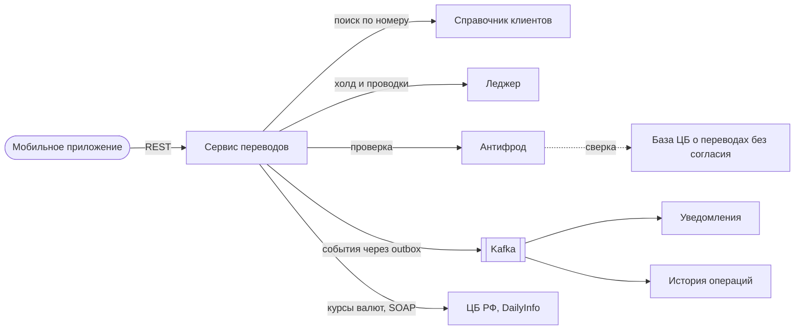

# Видение: переводы по номеру телефона

Версия 0.1. Банк и продукт вымышленные, правила продукта — мои решения в учебном проекте.

## Задача

Клиент банка переводит деньги другому клиенту этого же банка, зная только его номер телефона. Перевод должен быть понятен клиенту и надёжен для банка: ни одного двойного списания, ни одного зависшего перевода, ни одного уведомления о переводе, которого не было.

Проект сфокусирован на том, что происходит, когда что-то идёт не так: двойное нажатие, потерянный ответ, сбой антифрода, недоступный леджер, дубль события. Все такие случаи собраны в [таблице отказов](../design/failure-modes.md).

## Система и окружение

Проектирую сервис переводов и леджер: счета, холды, проводки. Мобильное приложение, справочник клиентов, антифрод, уведомления и история операций — внешние системы, для них описываю только контракты.

## Пользователи и стейкхолдеры

| Кто | Что важно |
|---|---|
| Отправитель | Перевести за пару нажатий, сразу понимать результат, не бояться повторного нажатия |
| Получатель | Узнать о зачислении и от кого оно |
| Служба безопасности | Каждый перевод проверен антифродом, сомнительные — на ручной проверке |
| Операционный отдел | Деньги сходятся, зависшие переводы видны сразу |

## Цели и метрики

Банк вымышленный, поэтому базовой линии нет: это целевые свойства системы, их проверяют тесты итерации 3.

| Цель | Метрика | Цель |
|---|---|---|
| Нет двойных списаний | Переводов с двумя списаниями по одному ключу идемпотентности | 0 |
| Нет зависших переводов | Переводов в промежуточном статусе дольше P-12, кроме ручной проверки | 0 |
| Деньги сходятся | Расхождений ежедневной сверки | 0 |
| Клиент быстро видит результат | Время от нажатия до финального статуса без ручной проверки | p95 не больше 3 с |
| Уведомления не дублируются | Повторных пушей об одном переводе | 0 |

## Границы

В рамках:
- поиск получателя по номеру телефона;
- переводы в рублях и между валютными счетами в одной валюте;
- лимиты на операцию, сутки и месяц;
- холд, проводки, сторно;
- антифрод, ручная проверка, приостановка с подтверждением клиентом по 161-ФЗ, отмена;
- события, уведомления, ежедневная сверка;
- курсы ЦБ для валютных лимитов.

Вне рамок:
- СБП и переводы в другие банки (точка расширения — транзитный счёт);
- переводы юрлицам;
- конвертация валют;
- комиссии;
- шаблоны, регулярные переводы, запрос денег.

## Допущения

| ID | Допущение |
|---|---|
| A1 | Справочник клиентов отвечает синхронно: номер → клиент → счета |
| A2 | У антифрода синхронный API для проверки и асинхронное решение по ручной проверке |
| A3 | Приложение умеет повторять запрос с тем же ключом идемпотентности |
| A4 | Kafka доставляет события «хотя бы один раз», дубли и перестановки возможны |
| A5 | Сверку с базой данных Банка России о переводах без согласия выполняет антифрод, сервис переводов к базе напрямую не обращается |

## Ограничения

- Противодействие переводам без согласия клиента (ст. 8 161-ФЗ в редакции 369-ФЗ, с 25.07.2024). Порядок — приостановка, уведомление, подтверждение клиентом, повторная сверка с базой ЦБ, отложенное исполнение — заложен в статусах и API (TR-35…TR-38). Сроки и состав признаков — параметры P-20 и P-21, согласуются с комплаенсом.
- Персональные данные и банковская тайна: имя получателя показывается сокращённо, в событиях и логах нет полных номеров телефонов и счетов.

## Риски

| Риск | Последствие | Что делаем |
|---|---|---|
| Антифрод долго недоступен | Переводы копятся на проверке, повторы добивают антифрод при восстановлении | Растущая пауза, предохранитель, ограниченный разбор очереди, алерт (TR-20) |
| Номера перебирают через поиск | Утечка: кто клиент банка | Лимиты частоты, сокращённое имя (TR-01, TR-03) |
| Ошибка в проводках | Деньги расходятся | Неизменяемые проводки, сторно, ежедневная сверка (TR-15, TR-31) |
| Сбой между записью статуса и событием | Клиент не узнаёт о переводе | Outbox (TR-27) |
| Сбой между записью статуса и следующим шагом | Перевод зависает, деньги заблокированы | Задача продолжения в той же транзакции (TR-30) |
